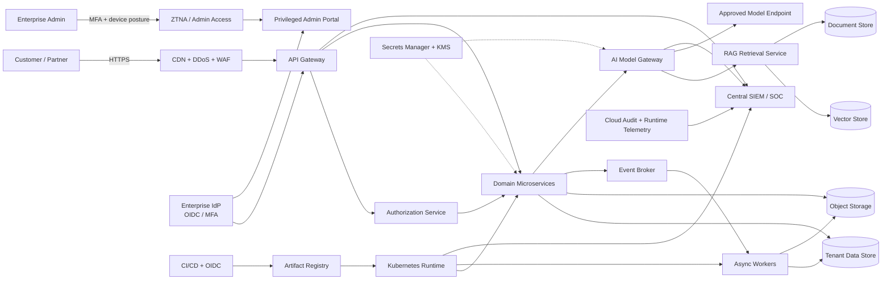

# 01 — System context and data-flow diagram

## System context

## Data-flow inventory

| ID | Source → destination | Data | Trust boundary / concern |
|---|---|---|---|
| DF-01 | Client → Edge | HTTPS request, cookies, uploads | Internet to enterprise edge; hostile input |
| DF-02 | Edge → API Gateway | HTTP request, identity context | Edge to application zone; header spoofing |
| DF-03 | API Gateway → IdP / authz | OIDC tokens, authorization context | Token validation, issuer/audience, key rotation |
| DF-04 | API Gateway → microservices | User and tenant-scoped request | Service identity, object-level authorization |
| DF-05 | Services → database | SQL, tenant key, sensitive records | Tenant isolation, injection, least privilege |
| DF-06 | Services → broker → workers | Events and payload references | Replay, poisoning, schema validation |
| DF-07 | Services → object store | Documents and exports | Malware, public exposure, retention |
| DF-08 | Services → AI gateway | Prompt, context, user request | Prompt injection, data leakage |
| DF-09 | RAG → vector/document store | Embeddings, chunks, metadata | Cross-tenant retrieval, poisoning |
| DF-10 | AI gateway → model provider | Minimized prompt/context | Third-party processing and retention |
| DF-11 | CI pipeline → cloud / registry | OIDC token, build artifact | Build compromise, excessive trust |
| DF-12 | Runtime → SIEM | Audit, security and runtime events | Integrity, coverage, sensitive log data |

## Assets and security objectives

| Asset | Classification | Primary security objectives |
|---|---|---|
| Customer identity and session | Restricted | Confidentiality, integrity |
| Tenant records and documents | Restricted | Tenant isolation, confidentiality, integrity |
| Signing keys and secrets | Critical | Confidentiality, integrity, rotation |
| Cloud control plane | Critical | Integrity, availability, accountability |
| Build pipeline and artifacts | Critical | Integrity, provenance |
| Model prompts, embeddings, retrieval corpus | Sensitive | Confidentiality, integrity, isolation |
| Audit and detection telemetry | Sensitive | Integrity, availability, traceability |

## Trust boundaries

1. **TB-1 Internet / edge:** all client input is untrusted; enforce WAF, rate limits, request-size limits, bot controls.
2. **TB-2 Edge / application:** do not trust forwarded identity headers unless cryptographically or operationally protected by the gateway; strip caller-supplied internal headers.
3. **TB-3 Application / data:** enforce tenant authorization in the service and data-access layer; use separate service identities and scoped permissions.
4. **TB-4 Application / AI provider:** minimize data, use approved endpoints and contractual controls, prevent secrets and regulated data from being sent without authorization.
5. **TB-5 Build / production:** deployment identity is separate from developer identity; promotion requires provenance and policy checks.
6. **TB-6 Admin / production:** privileged access requires phishing-resistant MFA, just-in-time elevation, approval, session logging, and break-glass review.

## Design review questions

- Can a user alter tenant identifiers in URL, body, headers, or event payloads?
- Does every API enforce object-level authorization, not merely role membership?
- Can an event be replayed, forged, or consumed by the wrong tenant?
- Can untrusted document content influence model tool execution?
- Can CI credentials deploy to unrelated accounts or namespaces?
- Can production workloads access the cloud metadata service or arbitrary internet destinations?
