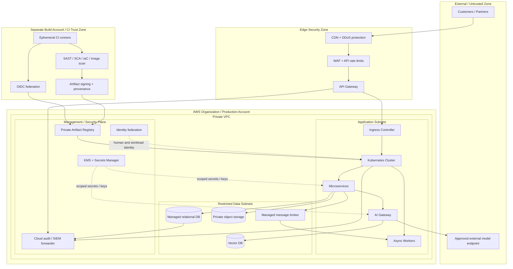

# 02 — Deployment architecture and trust zones

## Network and identity policy

| Zone | Inbound policy | Outbound policy |
|---|---|---|
| Edge | Internet HTTPS only; managed DDoS/WAF | API gateway origin only |
| Application | Only gateway/approved service paths | Explicit DB, broker, object, identity, telemetry, and model endpoints |
| Data | Only named application identities and ports | Backup, replication, monitoring, managed control plane |
| Management | Approved admin paths and service identities | Audit export, key services, approved management endpoints |
| Build | SCM webhook / controlled runner ingress | Dependency mirrors, scanners, cloud OIDC, registry |

## Kubernetes hardening baseline

- Enforce Pod Security Standards at `restricted` where workloads permit.
- Deny privileged containers, host PID/IPC/network, hostPath, and privilege escalation by default.
- Require non-root UID, read-only root filesystem, seccomp RuntimeDefault, dropped Linux capabilities.
- Apply default-deny ingress and egress NetworkPolicies, then allow only documented flows.
- Use namespace-scoped RBAC; avoid wildcard verbs/resources and cluster-admin service accounts.
- Use workload identity; disable automatic service-account token mounting when not needed.
- Verify image signatures and provenance; pin images by digest; block untrusted registries.
- Run admission policy for resource limits, approved registries, security context, and labels.
- Enable Kubernetes audit logs and runtime detection; alert on exec, privileged pod, RBAC, secret, and admission-policy changes.
- Separate production and non-production clusters/accounts; restrict control-plane access.

## Cloud guardrails

- Organization-level controls for regions, public exposure, encryption, audit logging, and prohibited services.
- Separate workload, security, logging, and build accounts.
- SCP / policy guardrails should prevent disabling critical audit controls and creating unrestricted public data stores.
- Use private endpoints and egress controls for sensitive services.
- Require encryption with managed keys, key rotation policy, backup protection, and tested restore.
- Alert on IAM trust-policy changes, privilege escalation, key policy changes, logging gaps, and public access changes.

## Availability and resilience

- Multi-AZ critical services, autoscaling with bounded maximums, queue back-pressure, circuit breakers, and dependency timeouts.
- DDoS and application rate limits; per-tenant quotas; upload size/type limits.
- Database backups with point-in-time recovery; immutable backup copies; periodic restore exercises.
- Define RTO/RPO by business service and validate through game days.
