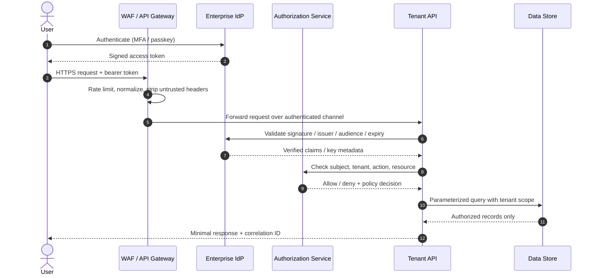

# 03 — Authentication and authorization sequence

## Mandatory validation rules

- Verify token signature against trusted issuer keys; support safe key rotation and cache invalidation.
- Validate exact issuer, audience, expiry, not-before, and permitted algorithm; reject unsigned or algorithm-confusion tokens.
- Do not accept tenant ID, role, subject, or admin status from caller-controlled headers or request fields.
- Treat token claims as authenticated identity attributes, not as proof that a requested object belongs to the caller.
- Enforce authorization at every resource operation (read, create, update, delete, export, admin action).
- Bind tenant context to verified identity and pass it through authenticated service-to-service context.
- Use short-lived tokens, refresh-token rotation, revocation strategy, and session anomaly detection.
- Service-to-service calls use workload identity and audience-bound tokens; no shared static credentials.
- Fail closed if identity or policy services are unavailable for sensitive operations.

## Negative test cases

1. Valid token with wrong audience → reject.
2. Expired token or future `nbf` → reject.
3. Token signed by unknown key or unexpected algorithm → reject.
4. User A requests User B's object ID → deny and emit authorization event.
5. Tenant A modifies a tenant ID in JSON/header/query → server ignores caller value or rejects.
6. Low-privilege user invokes admin endpoint → deny.
7. Revoked session uses previously issued refresh token → reject.
8. Service token with wrong audience or namespace identity → reject.
9. Policy engine timeout → fail closed for privileged/data-export operations.
10. Gateway spoofing attempt with internal identity header → stripped at edge; never used as source of truth.
