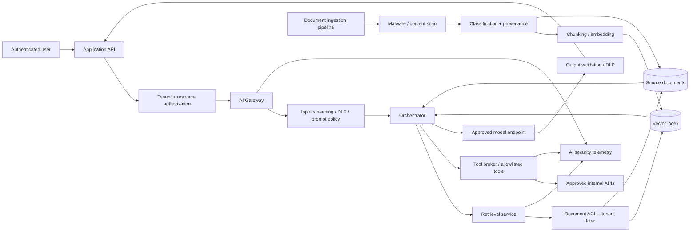

# 04 — AI / RAG architecture and threat boundaries

## AI-specific threats

| Threat | Attack path | Required control |
|---|---|---|
| Direct prompt injection | User asks model to ignore policy | Treat prompts as untrusted; policy outside model; constrain tools |
| Indirect prompt injection | Malicious instructions embedded in retrieved document | Scan/classify content; isolate instructions from data; tool authorization independent of model |
| Cross-tenant retrieval | Vector query omits tenant or ACL filter | Enforce tenant and document ACL filters server-side; negative isolation tests |
| Data exfiltration | Model output reveals secrets or other tenant data | Data minimization, DLP, output checks, retrieval authorization, secret isolation |
| Tool abuse | Model invokes privileged internal function | Typed schemas, allowlists, per-tool authorization, human approval for high-impact actions |
| RAG poisoning | Attacker uploads manipulated source content | Provenance, upload authorization, malware scanning, review, corpus integrity monitoring |
| Model denial of service | Large prompts / recursive agent calls | Token, time, concurrency and cost budgets; rate limits; circuit breakers |
| Sensitive training/log leakage | Prompts or responses retained too broadly | Retention limits, redaction, access controls, provider review, data processing assessment |
| Model supply-chain compromise | Untrusted model, adapter, or package | Approved model inventory, checksums/signatures, version pinning, evaluation before promotion |

## Non-negotiable design principles

- The model is not an authorization engine. Authorization is enforced by deterministic application services.
- Retrieved content is data, never executable policy or trusted instruction.
- Tool calls are independently authorized using the user's verified identity and tenant context.
- The model receives only the minimum context required for the task.
- The system must not expose system prompts, secrets, hidden chain-of-thought, or unrelated tenant data.
- Human approval is required for destructive, financial, external communication, or privilege-changing actions.
- Log security-relevant metadata and decisions, but redact secrets and minimize sensitive prompt/response retention.

## AI validation scenarios

- Put a prompt injection string in a retrieved PDF and verify it cannot trigger a tool call.
- Attempt retrieval using a tenant-A identity against tenant-B document IDs and embeddings.
- Ask the model to reveal system instructions, secrets, or another tenant's data.
- Attempt tool invocation with missing, malformed, or over-privileged arguments.
- Submit oversized, deeply nested, or repeated prompts and verify resource budgets.
- Upload poisoned or mislabeled documents and verify quarantine and provenance checks.
