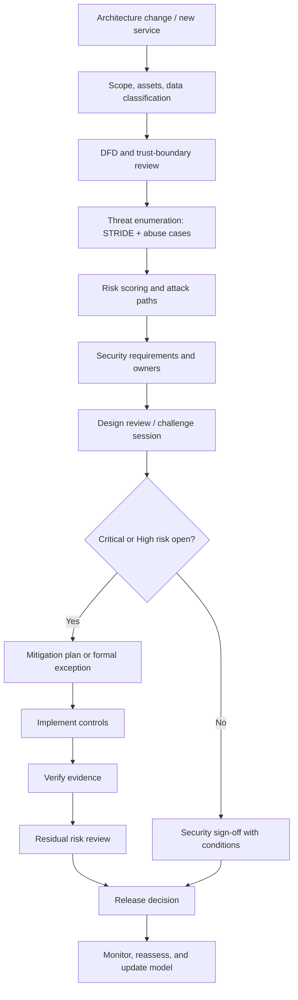

# Threat-model governance and architecture review process

## Lifecycle

## RACI

| Activity | Product owner | Solution architect | Security architect | Engineering | SRE / SOC | Risk owner |
|---|---|---|---|---|---|---|
| Scope and business impact | A | R | C | C | C | I |
| DFD and trust boundaries | C | R | A | R | C | I |
| Threat identification | C | R | A/R | R | C | I |
| Risk scoring | C | C | R | C | C | A |
| Control design | I | R | A | R | R | I |
| Control implementation | I | C | C | A/R | R | I |
| Evidence validation | I | C | A | R | R | I |
| Risk acceptance | C | I | C | I | I | A/R |
| Monitoring and reassessment | I | C | A | R | R | I |

R = Responsible, A = Accountable, C = Consulted, I = Informed. One accountable role is assigned per activity; adapt titles to the organization's governance model.

## Review triggers

Re-open the model when:
- a new internet-facing endpoint, data store, trust relationship, or privileged workflow is introduced;
- tenant model, authentication, authorization, or encryption changes;
- a new AI model, tool, retrieval source, or external provider is integrated;
- cloud account, cluster, network, or CI/CD trust boundaries change;
- a critical vulnerability, security incident, or material threat-intelligence change affects assumptions;
- a control fails, telemetry disappears, or a risk exception expires.

## Exception / risk acceptance minimum fields

- Threat ID and affected assets / services.
- Business justification and impact of delaying remediation.
- Inherent and residual risk with scoring rationale.
- Compensating controls and monitoring owner.
- Named accountable business risk owner and security approver.
- Expiry date (recommended maximum 90 days for High/Critical, subject to policy).
- Remediation milestone and review cadence.
- Automatic escalation for expiry or missed milestone.

Security teams advise and challenge; the accountable business risk owner accepts business risk. A technical team cannot self-approve its own Critical risk exception.

## Suggested service-level objectives

| Risk | Initial triage | Treatment plan | Target remediation |
|---|---:|---:|---:|
| Critical | 1 business day | 2 business days | Before production release; active exposure mitigated immediately |
| High | 3 business days | 5 business days | 30 days or approved exception |
| Moderate | 10 business days | 15 business days | 90 days |
| Low | 20 business days | Next planned cycle | 180 days / risk-based |

These are example governance targets, not universal regulatory requirements. Align them with business criticality and incident response policy.
