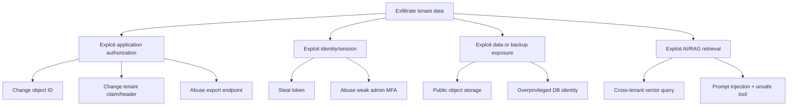
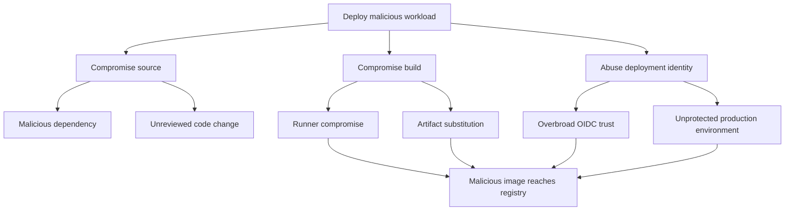
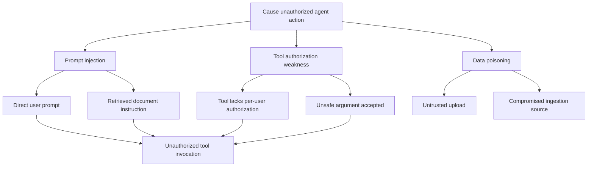

# Attack trees and adversary paths

## AT-01 — Exfiltrate tenant data

**Goal:** obtain data belonging to another tenant.

**Control strategy:** object-level authorization, tenant-bound claims, phishing-resistant MFA, short-lived tokens, private storage, scoped DB identities, tenant-aware retrieval, tool broker authorization, DLP, and exfiltration detection.

## AT-02 — Compromise production through CI/CD

**Control strategy:** protected branches, CODEOWNERS, dependency pinning, isolated ephemeral runners, SBOM, provenance attestations, image signing, digest pinning, OIDC subject restrictions, protected environments, deployment approval, admission signature verification, and runtime monitoring.

## AT-03 — Abuse AI agent capabilities

**Control strategy:** deterministic policy enforcement outside the model, strict tool allowlists, typed schemas, per-action authorization, human approval for high-impact operations, source provenance, quarantine, and full tool-call audit.

## ATT&CK mapping (hypothesis for detection engineering)

| Attack path | Relevant ATT&CK behavior to investigate | Defensive telemetry |
|---|---|---|
| Stolen credentials | Valid Accounts | IdP sign-in, token anomalies, MFA events |
| Cloud privilege abuse | Cloud account / permission discovery and privilege escalation behaviors | Cloud audit, IAM changes, role assumption |
| Container compromise | Container administration and escape-related behaviors | Kubernetes audit, runtime process and syscall telemetry |
| CI/CD compromise | Compromise software supply chain | SCM audit, runner events, artifact provenance |
| Data exfiltration | Exfiltration over web service / cloud storage | API logs, object access, egress, DLP |
| Service disruption | Network denial of service / resource exhaustion | WAF, API quotas, queue depth, model token/cost metrics |

Technique IDs should be confirmed against the current MITRE ATT&CK knowledge base before use in a formal detection catalog. This project does not claim observed adversary activity.
