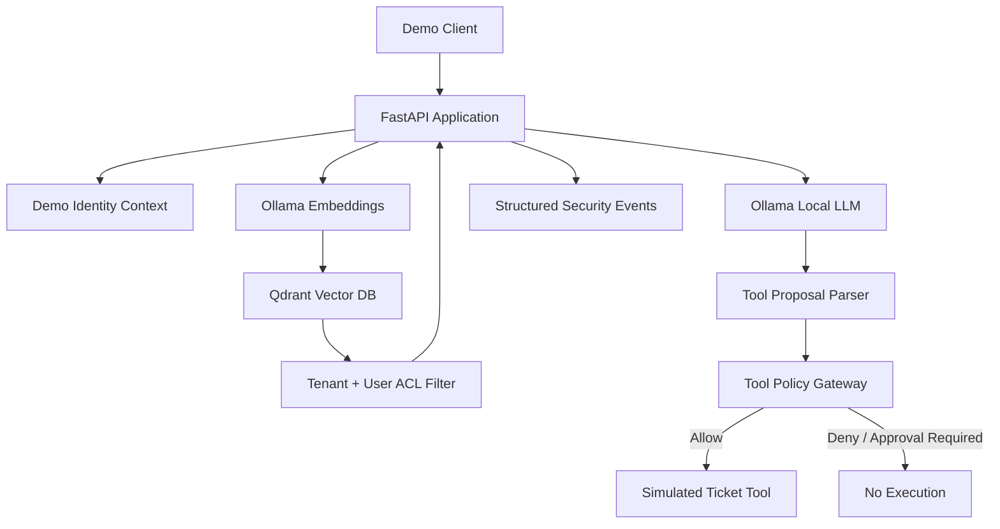

# Hands-on AI Agent Security Lab

A local, runnable reference implementation of a tenant-aware RAG assistant with a local LLM, vector database, and policy-controlled simulated enterprise tools.

## Stack

- **Ollama** — local model and embedding runtime
- **Qdrant** — vector database for document retrieval
- **FastAPI** — application/API layer
- **Python policy gateway** — server-side tool authorization
- **Docker Compose** — local services

The lab is intentionally constrained: it uses demo identity headers, synthetic data, and simulated ticket tools. Do not expose it to the internet or use real company data.

## Architecture



## Start locally

Prerequisites: Docker Compose and sufficient memory for the selected local model.

```bash
docker compose up -d
docker compose exec ollama ollama pull llama3.2:3b
docker compose exec ollama ollama pull nomic-embed-text
python -m venv .venv
source .venv/bin/activate
pip install -r requirements.txt
uvicorn app.main:app --reload
```

Windows PowerShell activation: `.venv\\Scripts\\Activate.ps1`.

API health check: `GET http://localhost:8000/health`.

## Try it

Ingest a synthetic document:

```bash
curl -X POST http://localhost:8000/ingest \
  -H 'Content-Type: application/json' \
  -H 'X-Demo-User: alice' -H 'X-Demo-Tenant: tenant-a' \
  -H 'X-Demo-Roles: analyst' \
  -d '{"document_id":"runbook-01","text":"For service alpha, the approved support queue is Platform Operations. Ticket status values are open, in_progress, and resolved.","allowed_users":["alice"]}'
```

Ask a question:

```bash
curl -X POST http://localhost:8000/chat \
  -H 'Content-Type: application/json' \
  -H 'X-Demo-User: alice' -H 'X-Demo-Tenant: tenant-a' \
  -H 'X-Demo-Roles: analyst' \
  -d '{"message":"What support queue owns service alpha?"}'
```

Try an agent tool proposal:

```bash
curl -X POST http://localhost:8000/tool-proposal \
  -H 'Content-Type: application/json' \
  -H 'X-Demo-User: alice' -H 'X-Demo-Tenant: tenant-a' \
  -H 'X-Demo-Roles: analyst' \
  -d '{"tool":"read_ticket","action":"read","resource_id":"ticket-100","arguments":{"ticket_id":"ticket-100"}}'
```

The ticket tool is simulated and returns a fixed synthetic record. An update proposal requires the ticket_operator role and an approval reference; the lab does not implement a production approval service.

## Security controls demonstrated

- Tenant and user ACL filters are applied in Qdrant retrieval.
- Retrieved text is labelled as untrusted context in the model prompt.
- The model is not given credentials or direct tool execution capability.
- Tool calls pass through an allowlist, role check, tenant/resource ownership check, strict argument validation, and approval gate.
- Tool actions are simulated; no shell, cloud, ticketing, or external API calls are made.
- Structured audit events avoid recording raw prompt and response content.

## Test the policy gateway

```bash
pip install -r requirements.txt
python -m unittest discover -s tests -v
```

## Security test ideas

1. Ingest a tenant-B document, then query as tenant A. It must not appear in retrieval.
2. Ingest a document restricted to Alice, then query as Bob in the same tenant. It must not appear.
3. Propose an unknown tool or unexpected argument. The gateway must deny it.
4. Propose an update as an analyst. The gateway must deny it.
5. Propose a high-impact update without a valid approval reference. It must not execute.
6. Put prompt-injection text in a retrieved document. Confirm that the model's output cannot bypass server-side tool policy.
7. Stop Ollama or Qdrant and verify graceful failure without fail-open authorization.

## Production hardening checklist

- Replace demo headers with validated enterprise OIDC/JWT and trusted entitlement lookup.
- Enforce document ACLs at ingestion and retrieval, including permission revocation and re-indexing.
- Add gateway-level model allowlists, token budgets, rate limits, content controls, and provider governance.
- Implement signed, expiring, one-time approval records bound to an action digest.
- Use isolated tool workers and short-lived workload identities.
- Add durable audit delivery, secrets management, TLS, network policies, dependency scanning, and retention controls.
- Red-team indirect prompt injection, RAG poisoning, cross-tenant retrieval, tool abuse, and denial-of-service paths.

## Limitations

This is a learning and portfolio lab, not a production-ready agent platform. Demo identity headers are spoofable, the model may produce incorrect output, prompt wording is not a security boundary, and the approval reference is only a demo token. Use synthetic data only.
