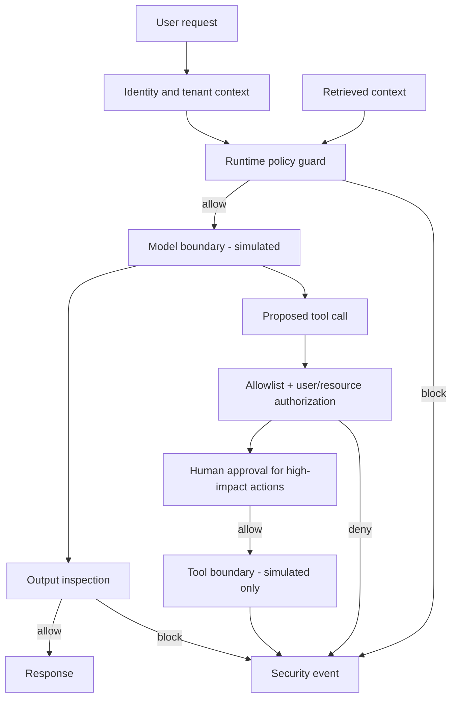

# AI Runtime Security Lab

A local, deterministic simulation of runtime guardrails for AI-enabled applications. It demonstrates policy enforcement and security telemetry using synthetic events—without calling a model, executing tools, scanning a network, or connecting to external systems.

## Threat scenarios demonstrated

1. Prompt injection in user input or retrieved context.
2. Cross-tenant context mismatch.
3. Unauthorized or unknown agent tool invocation.
4. High-impact tool action without human approval.
5. Sensitive data in model output and telemetry redaction.
6. Excessive requests per subject.
7. Oversized prompt/output and tool-call budget limits.

## Architecture



## How to run

Requires Python 3.10+ and the standard library only.

```bash
cd projects/ai-runtime-security-lab
python runtime_guard.py --input scenarios/runtime-events.json --output runtime-report.json
python -m unittest discover -s tests -v
```

The sample output is a JSON security event report with allow/block decisions and reasons. No external service is contacted.

## Control model

- **Prompt/context inspection:** heuristic indicators for common instruction-override language in both prompt and retrieved context.
- **Tenant binding:** compares authenticated tenant context with the resource tenant identifier supplied by the trusted application layer.
- **Tool authorization:** server-side allowlist plus separate user and resource authorization flags.
- **Human approval:** blocks configured high-impact tools without an approval signal.
- **Abuse controls:** request count per subject, prompt/output size, and per-request tool-call budget.
- **Output/telemetry hygiene:** synthetic secret-pattern detection and preview redaction.

## Limitations

This is a teaching harness, not a production security product. Pattern matching can miss attacks and create false positives. The in-memory request counter is not distributed, persistent, or time-windowed. Tenant identifiers and authorization booleans must come from trusted middleware in a real service. Production controls require cryptographic identity validation, authoritative policy decisions, durable rate limiting, robust DLP, model-specific evaluation, monitoring, and incident response.

## Safe-use boundary

All scenarios use synthetic data. The harness does not run shell commands, invoke tools, access cloud resources, call external models, or send traffic. Do not add real credentials, customer data, or private prompts to the public repository.
