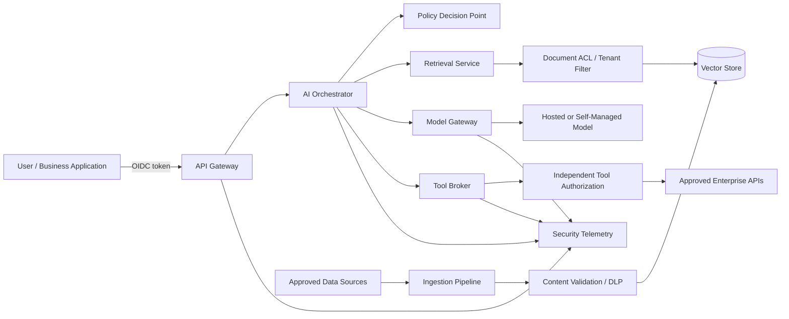

# Enterprise AI Reference Architecture and Trust Boundaries

## Logical architecture

## Trust boundaries

1. **User to API gateway:** authenticate the caller, validate issuer/audience/expiry, apply rate limits, and bind a stable subject and tenant context.
2. **Orchestrator to retrieval:** pass verified identity context; retrieval service independently enforces tenant and document-level authorization.
3. **Ingestion to index:** treat source documents as untrusted; validate provenance, file type, malware/content policy, classification, and ACL metadata before indexing.
4. **Orchestrator to model:** send only authorized, minimized context; apply provider and region policy; protect API credentials and log metadata safely.
5. **Model to tool broker:** treat model-generated tool calls as untrusted requests. The broker validates schema, allowlist, user entitlement, resource scope, and action risk.
6. **Tool broker to enterprise APIs:** downstream APIs enforce their own authorization. Never assume the model or broker's decision is sufficient.
7. **Telemetry boundary:** restrict access, redact secrets and sensitive data, define retention, and protect audit integrity.

## Core invariants

- A model cannot grant itself permissions.
- Prompt text cannot override server-side policy.
- Retrieval results must be authorized for the requesting user before prompt assembly.
- A tool call must be authorized for the specific user, resource, and action.
- Untrusted documents and model output cannot directly execute code or commands.
- Secrets are injected by a trusted secret manager, never placed in prompts or training data.
- High-impact actions require explicit approval and an auditable transaction record.

## Abuse cases to model

- Indirect prompt injection embedded in a retrieved document.
- Cross-tenant retrieval through missing metadata filters or cache-key collisions.
- Model-generated tool invocation against an unauthorized resource.
- Poisoned ingestion content changing model behavior or retrieval ranking.
- Excessive inference or recursive tool use causing cost or availability impact.
- Sensitive information exposed through output, logs, traces, or provider retention.
- Compromised model, adapter, tokenizer, dataset, or build dependency entering production.

## Deployment considerations

For Kubernetes deployments, apply workload identity, namespace isolation, network policies, admission controls, signed images, resource quotas, restricted pod security, secret rotation, and runtime monitoring. Separate model-serving GPU pools from general workloads where practical. Restrict outbound network access from inference and tool-execution components.
