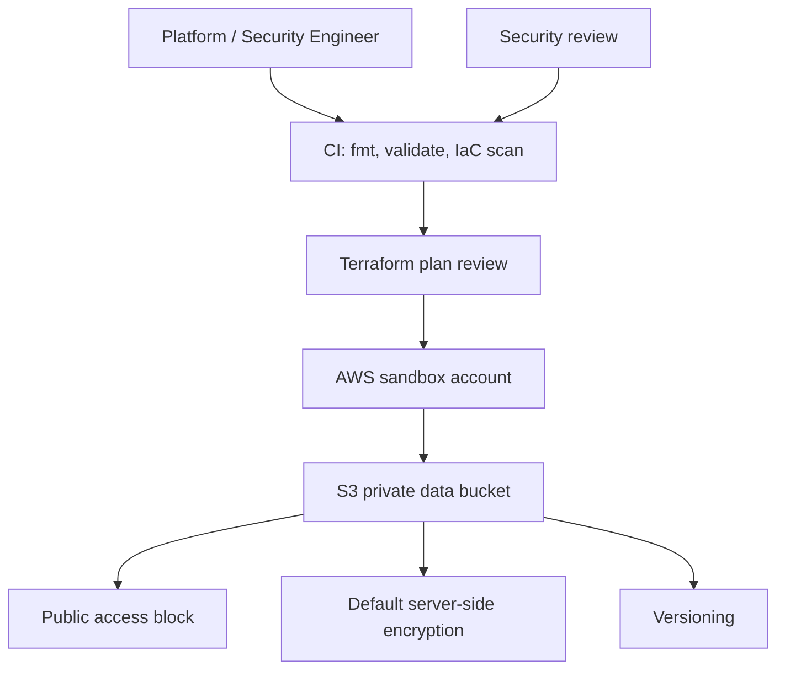

# Cloud Security Posture Lab — Architecture

## Scope

A small AWS foundation example implemented in Terraform. It creates one private S3 bucket with public-access protections, server-side encryption, and versioning. It is intentionally narrow so each control can be reviewed and tested.

## Logical architecture

## Control mapping

| Control | Terraform resource | Security intent |
|---|---|---|
| Block public ACLs and policies | `aws_s3_bucket_public_access_block` | Reduce accidental public exposure |
| Default encryption | `aws_s3_bucket_server_side_encryption_configuration` | Protect stored objects at rest |
| Versioning | `aws_s3_bucket_versioning` | Support recovery from overwrite/deletion |

## Deployment workflow

1. Use a dedicated non-production AWS account and least-privilege role.
2. Run `terraform fmt -check` and `terraform validate`.
3. Run an IaC scanner and review all findings.
4. Inspect `terraform plan` for unintended resources or policy changes.
5. Obtain the required change approval before applying.
6. Verify the bucket configuration after deployment.
7. Destroy lab resources when finished.

## Deliberate limitations

This is not a complete enterprise landing zone. It does not configure organization-level SCPs, CloudTrail, centralized logging, KMS key policies, access points, data classification, or lifecycle controls. Those should be separate modules with explicit ownership and tests.
