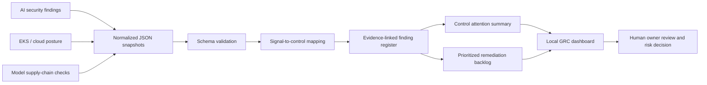

# Continuous Compliance Integration Architecture

## Integration boundaries

The reference implementation consumes portable JSON exports. Each source is responsible for authenticating its own data, preserving original identifiers, timestamps, severity and evidence references. A production adapter should validate source authenticity, enforce tenant boundaries, redact sensitive content, record ingestion time and source version, and prevent replay or duplicate ingestion.

## Data flow and governance

1. Source systems export a scoped snapshot.
2. The pipeline validates required fields and unique IDs.
3. Signal names map to the existing GRC control catalogue.
4. Each finding is retained with its source and evidence reference.
5. Unresolved findings create a remediation work item with a suggested owner role and action.
6. Control summaries distinguish attention required, accepted risk, and no mapped finding in the current snapshot.
7. A human control owner validates evidence, closure and residual risk.

## Production extension points

Implement separate adapters for approved vendor APIs and native connectors; use short-lived credentials and read-only scopes; store raw exports and normalized records in access-controlled immutable storage; integrate ticketing through a reviewed write-back service; and maintain signed provenance, schema versioning, retention, access logs and exception governance. Never place API keys or customer telemetry in this repository.
