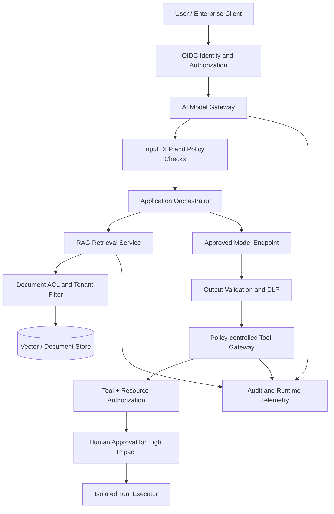

# Enterprise AI Security Architecture

A reference architecture and runnable policy-engineering starter for securing enterprise LLM and agentic AI applications. It focuses on identity, retrieval, tool authorization, human approval, model gateway policy, data protection, and runtime monitoring.

This independent portfolio lab uses synthetic data and simulated tools. It does not connect to a real model provider, enterprise identity provider, vector database, or production tool.

## Architecture



## Security control domains

| Domain | Required control | Lab artifact |
|---|---|---|
| Identity | OIDC, short-lived tokens, tenant and role claims | docs/IDENTITY-AND-TENANCY.md |
| Model gateway | Model allowlist, rate/token limits, policy enforcement | config/model-gateway-policy.yaml |
| RAG | Tenant/document ACL filtering, provenance, ingestion quarantine | docs/RAG-SECURITY.md |
| Agent tools | Tool allowlist, argument schema, resource authorization | src/tool_gateway.py |
| Human approval | Explicit approval for high-impact operations | src/tool_gateway.py |
| Data protection | Classification, secret/PII detection, minimization, output checks | docs/DATA-PROTECTION.md |
| Runtime | Security events, trace correlation, alerting and response | docs/RUNTIME-MONITORING.md |
| Governance | Threat model, ownership, exception expiry, evidence | docs/THREAT-MODEL.md |

## How to run

Requires Python 3.10+ and uses only the standard library.

```bash
cd projects/enterprise-ai-security-architecture
python -m unittest discover -s tests -v
```

The tests validate the local tool gateway allowlist, role and resource checks, approval requirement, and input validation. No real tool action is executed.

## Recommended production integration pattern

1. Authenticate users with enterprise OIDC; derive tenant and roles from verified claims.
2. Route model calls through a centrally governed gateway with approved model/provider allowlists, quotas, logging controls, and data policies.
3. Enforce document authorization before retrieval results enter model context.
4. Treat retrieved documents and model output as untrusted.
5. Route all agent tool calls through a separate policy enforcement point.
6. Re-authorize the user, tool, target resource, and arguments at execution time.
7. Require human approval for high-impact actions; bind approval to the exact action and parameters.
8. Emit privacy-aware audit events with correlation IDs and defined retention.
9. Test direct/indirect prompt injection, cross-tenant access, tool abuse, data leakage, and resource exhaustion before release.

## Limitations

- The included gateway is a local policy demonstration, not a network service or production authorization framework.
- The approval callback is a simulated boolean input, not a secure approval workflow.
- No actual LLM, vector store, OIDC provider, DLP engine, SIEM, or cloud API is integrated.
- Detection examples are not complete prevention mechanisms.
- Production use requires independent security review, threat modelling, integration testing, and operational ownership.

## Project map

- docs/ARCHITECTURE.md
- docs/THREAT-MODEL.md
- docs/IDENTITY-AND-TENANCY.md
- docs/RAG-SECURITY.md
- docs/AGENT-TOOL-SECURITY.md
- docs/DATA-PROTECTION.md
- docs/RUNTIME-MONITORING.md
- config/model-gateway-policy.yaml
