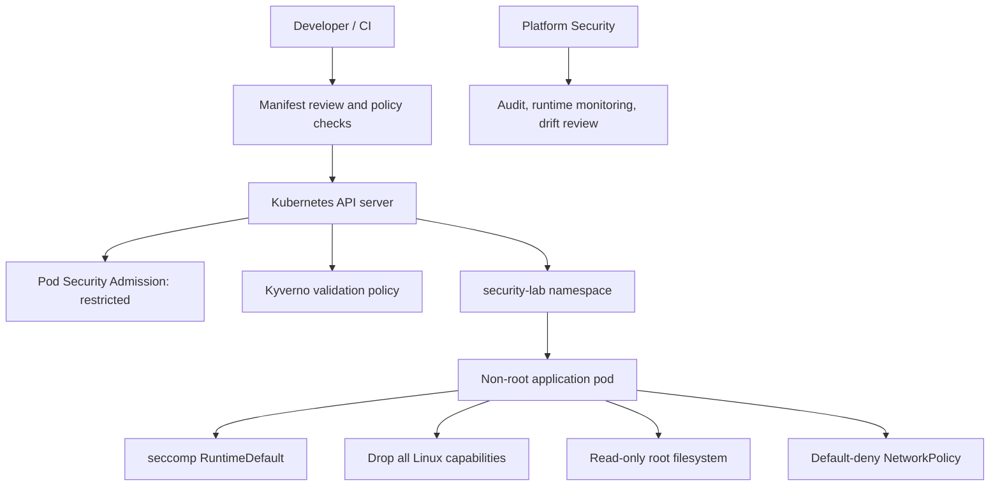

# Kubernetes Security Lab — Architecture

## Design overview

The lab applies namespace-level Pod Security Admission, a hardened workload security context, and a default-deny network policy. A Kyverno policy example adds admission-time validation for selected pod hardening controls.

## Security controls

- Pod Security Admission labels set the namespace to `restricted`.
- Workload runs as a non-root UID/GID and disables automatic service-account token mounting.
- Container disallows privilege escalation, drops all capabilities, uses seccomp RuntimeDefault, and has a read-only root filesystem.
- CPU and memory requests/limits are declared.
- Default-deny ingress and egress policy is applied.

## Operational notes

A default-deny egress policy blocks DNS and external dependencies until explicit allow rules are added. NetworkPolicy enforcement depends on the CNI. Validate image compatibility with non-root and read-only filesystem settings. Pin production images by immutable digest and use a trusted registry.
