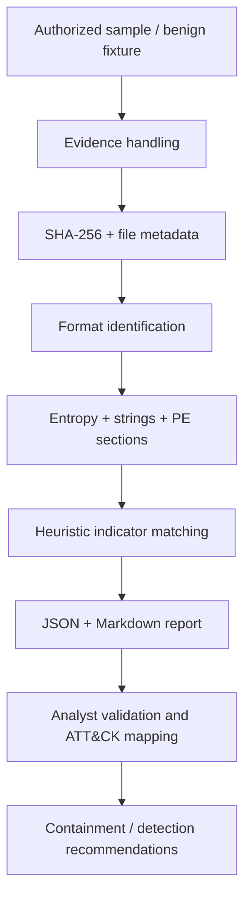

# Malware Analysis & Reverse Engineering Lab

A defensive, offline malware-triage and reverse-engineering learning module. It provides a safe static-analysis workflow, file metadata and hash collection, entropy and printable-string extraction, PE/ELF/Mach-O identification, heuristic capability indicators, and reproducible JSON/Markdown reports.

**Safety boundary:** this repository contains no live malware, exploit, loader, payload, or executable sample. The analyzer never executes, loads, unpacks, emulates, or contacts a file. Use only benign fixtures or samples you are explicitly authorized to handle, inside an isolated analysis environment.

## Learning objectives

- Establish evidence handling, sample provenance, SHA-256 and chain-of-custody basics.
- Identify common executable formats and inspect PE structure safely.
- Use strings, imports/exports and section metadata as leads—not proof of maliciousness.
- Recognize persistence, process injection, defense evasion, credential access and network capability indicators.
- Build a repeatable static triage report and map observations to MITRE ATT&CK.
- Understand when controlled dynamic analysis and reverse engineering in Ghidra/IDA/radare2 are appropriate.

## Architecture



## Repository map

- `tools/triage.py` — offline static triage CLI; never executes the input.\n- `tools/advanced_analysis.py` — bounded PE import parsing, IOC extraction, optional YARA matching, and sandbox-report normalization.\n- `yara/` — low-confidence educational YARA rules and usage notes.\n- `fixtures/sandbox-report-demo.json` — synthetic sandbox report for IOC extraction practice.\n- `docs/advanced-analysis.md` — advanced analysis workflow and input schema.
- `config/indicator-rules.json` — transparent heuristic indicator catalogue.
- `tests/test_triage.py` — unit tests using temporary benign files.
- `docs/static-analysis-methodology.md` — evidence handling and analysis workflow.
- `docs/reverse-engineering-playbook.md` — Ghidra/IDA/radare2 workflow and code-reading checklist.
- `docs/sandbox-and-dynamic-analysis.md` — isolated lab design and dynamic-analysis safety.
- `docs/mitre-attack-mapping.md` — capability-to-technique mapping guidance.

## How to run

Requires Python 3.10+; standard library only. From the repository root:

```bash
python projects/malware-analysis-reverse-engineering/tools/triage.py --input projects/malware-analysis-reverse-engineering/fixtures/benign-indicator-demo.txt --output-dir projects/malware-analysis-reverse-engineering/reports
python projects/malware-analysis-reverse-engineering/tools/advanced_analysis.py --sandbox-report projects/malware-analysis-reverse-engineering/fixtures/sandbox-report-demo.json --output ./analysis-output/advanced.json\npython -m unittest discover -s projects/malware-analysis-reverse-engineering/tests -v
```

The fixture is harmless plain text containing example API-name strings to demonstrate heuristic matching. It is not malware and does not contain executable code. The report is written to `reports/latest.json` and `reports/latest.md`.

Analyze an authorized file by providing its path:

```bash
python projects/malware-analysis-reverse-engineering/tools/triage.py --input /path/to/authorized-sample --output-dir ./analysis-output
```

The tool reads bytes only. It does not execute or modify the sample. Output may contain sensitive paths, strings, domains, usernames or other indicators; keep reports private and do not commit real sample data.\n\n### Advanced analysis\n\nThe advanced helper can parse PE import names, extract candidate IOCs from file strings, and normalize an existing JSON report exported by an approved sandbox. It never starts or controls a sandbox.\n\n```bash\npython projects/malware-analysis-reverse-engineering/tools/advanced_analysis.py --input /path/to/authorized-sample --output ./analysis-output/advanced.json\npython projects/malware-analysis-reverse-engineering/tools/advanced_analysis.py --sandbox-report projects/malware-analysis-reverse-engineering/fixtures/sandbox-report-demo.json --output ./analysis-output/sandbox-iocs.json\n```\n\nYARA is optional. Install `yara-python` only in your isolated analysis environment, then add `--yara-rules projects/malware-analysis-reverse-engineering/yara/educational-capability-indicators.yar`. The sample rules are generic low-confidence training patterns; they are not malware signatures.

## Static triage workflow

1. Record source, acquisition time, handler, authorization and original filename.
2. Preserve the original as read-only; work on a verified copy in an isolated VM.
3. Calculate SHA-256 and compare against trusted internal or vendor intelligence sources.
4. Identify format and architecture; inspect headers, sections, imports, exports, resources and signing metadata with trusted parsers.
5. Review strings and entropy by section; investigate anomalies in context.
6. Correlate capabilities and indicators with behavior hypotheses and ATT&CK techniques.
7. Validate with independent tools and controlled dynamic analysis where authorized.
8. Produce a confidence-rated assessment, IOCs, detection opportunities and remediation actions.

## Important interpretation notes

- High entropy can indicate compression, encryption, packed content, or ordinary data. It is not a malware verdict.
- API names in strings do not prove that APIs are imported or called.
- Heuristic matches are leads for analyst review; benign software can use the same APIs.
- A lack of indicators does not establish that a file is safe.
- The lightweight PE import parser is bounded and educational; unusual or malformed files may not parse completely. Use maintained PE parsers such as pefile or LIEF for production analysis. IOC extraction and YARA hits are candidate signals, not verdicts.

## Tooling for deeper analysis

- **Ghidra:** function discovery, disassembly, decompilation, cross-references and call graphs.
- **IDA Free:** interactive disassembly and function-level investigation.
- **radare2/Cutter:** command-line and graphical binary inspection.
- **Detect It Easy (DIE):** compiler, packer and file-format clues.
- **FLOSS / strings:** string extraction, including obfuscated string recovery where appropriate.
- **YARA:** maintainable pattern-based classification; validate rules against benign and known test corpora.

Install tools from their official sources and verify package signatures/checksums where available. Do not upload confidential samples to public multi-scanners without data-owner approval.

## Limitations and safety

This is a learning-grade static triage utility, not an antivirus, sandbox, unpacker, decompiler or malware verdict system. YARA matching is an optional wrapper around `yara-python`, not a bundled YARA engine. It does not perform dynamic execution, network capture, memory forensics, anti-analysis bypass, exploit development or persistence installation. Never disable endpoint protection or connect an unknown sample to a production network. See the sandbox guide before any dynamic analysis.
